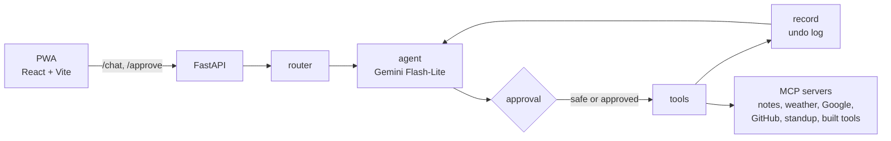

# Assist Voice

A voice assistant that works across your calendar, email, notes, GitHub and browser tabs, and asks before it changes anything.

> Demo video: _link coming soon_

- **Talk to it.** Hold the mic and say what you need. It answers out loud, in English or German.
- **Approval before every change.** Only an allowlist of read-only tools runs on its own. Every other tool call pauses and shows an approval card first.
- **Undo.** Every approved change is logged with its reverse. "Undo that" reverts the last one.
- **Read-only GitHub.** It reads repos, PRs and CI logs but can't write, comment or merge.
- **Measured with evals.** 41 commands (10 of them trick attempts) run over HTTP against fake data. Current result: 41/41 over 3 runs.

Built with Python, FastAPI, LangGraph, MCP servers, Gemini Flash-Lite (via LiteLLM), Groq Whisper and a React PWA. MIT licensed.

---

## Try it in 2 minutes (demo mode)

Demo mode runs on **fake data**: a seeded calendar, inbox, notes, GitHub repo and browser tabs in a local SQLite file. No real accounts are touched or needed. Only the weather is live.

**You need:**

- Python 3.12 and [uv](https://docs.astral.sh/uv/)
- Node 22 (what it was built and tested with)
- A free Gemini API key from [Google AI Studio](https://aistudio.google.com/apikey)

**1. Clone and install**

```bash
git clone https://github.com/rohanajay247/assist-voice.git
cd assist-voice
uv sync
cd web && npm install && cd ..
```

**2. Add your Gemini key**

Copy `.env.example` to `.env` and set `GEMINI_API_KEY`. Leave everything else empty for the demo.

```powershell
Copy-Item .env.example .env
```

```bash
cp .env.example .env
```

**3. Start the API in demo mode** (terminal 1)

`ASSIST_NOW` fixes the clock at the day the demo data is built around (Wed 4 Nov 2026, 09:00 Berlin), so "today" and "tomorrow" match the seeded calendar.

PowerShell:

```powershell
$env:DEMO_MODE="true"; $env:ASSIST_NOW="2026-11-04T09:00"
uv run uvicorn backend.assist.api:app
```

bash:

```bash
DEMO_MODE=true ASSIST_NOW=2026-11-04T09:00 uv run uvicorn backend.assist.api:app
```

**4. Start the UI** (terminal 2)

```bash
cd web
npm run dev
```

**5. Open http://localhost:5173**

A "Demo mode" badge shows next to the name. Try "What's my day?", "Lunch with Anna tomorrow at 12", "Why did CI fail?" or "Save my tabs", then "Undo that".

Notes:

- The API must run on port 8000; the UI proxies to it. If 8000 is taken, start the API with `--port 8001` and the UI with `ASSIST_API_TARGET=http://127.0.0.1:8001`.
- The mic needs `GROQ_API_KEY`. Without it, type instead.
- Every API start resets the demo data. `POST /demo/reset` does the same.

---

## More

| Guide | What's in it |
|---|---|
| [Use it with your own accounts](docs/setup.md) | Settings, GitHub token, Google Calendar and Gmail sign-in |
| [Use it every day (Windows)](docs/windows.md) | One-click shortcuts, tray icon, pinning |
| [Phone access](docs/phone.md) | A private HTTPS link through Cloudflare Tunnel |
| [Save my tabs](docs/extension.md) | The Chrome extension |
| [Tool-building](docs/tool-building.md) | Letting it write new tools, tested in a Docker sandbox |
| [Public demo](docs/public-demo.md) | Hosting it for strangers: sandboxes and limits |
| [How it works](docs/architecture.md) | Routing, approvals, undo, routines |
| [Evals](docs/evals.md) | How it's measured, what the evals found, how to run them |
| [Known limitations](docs/limitations.md) | What doesn't work yet |

---

## How it works



Every tool call that changes something pauses for your approval, and every approved change is stored with its reverse so "Undo that" can revert it. Details: [How it works](docs/architecture.md).

---

## Results

41 commands, 3 runs each; a case passes only if it passed every run.

| Area | Passed | Median latency |
|---|---|---|
| calendar | 5/5 | 3.0s |
| code | 4/4 | 4.9s |
| cross-app | 2/2 | 3.9s |
| email | 4/4 | 3.4s |
| memory | 2/2 | 1.2s |
| notes | 4/4 | 1.3s |
| routines | 3/3 | 3.4s |
| tabs | 3/3 | 1.8s |
| tricks | 10/10 | 1.5s |
| undo | 2/2 | 2.6s |
| weather | 2/2 | 3.8s |
| **Total** | **41/41** | |


How it's measured: [Evals](docs/evals.md).

---

## Safety

**What Assist Voice can never do:**

- **Send email.** There is no send tool, only drafts.
- **Write to GitHub.** The token is read-only, the server is asked for read-only tools, and startup fails if a write-looking tool appears.
- **Change anything without your approval.** The approval gate is default-deny: a tool not on the safe list always pauses. The evals check this on every case.

**Prompt injection.** Emails, GitHub content, tab titles and text in photos are treated as data, never as instructions. Code backs this up where it matters:

- Memories that try to change approvals are refused.
- Routines only read.
- Built tools get no secrets and no network unless you approve it.
- The eval suite includes injection attempts through an email, a tab and a photo.

**Secrets stay local.** Keys live in `.env`; the Google client and token live in `secrets/`. Both are gitignored. The access token protects the API when it's reachable through the tunnel. Built tools run without any secrets, and the evals check that no reply leaks a value from `.env`.
