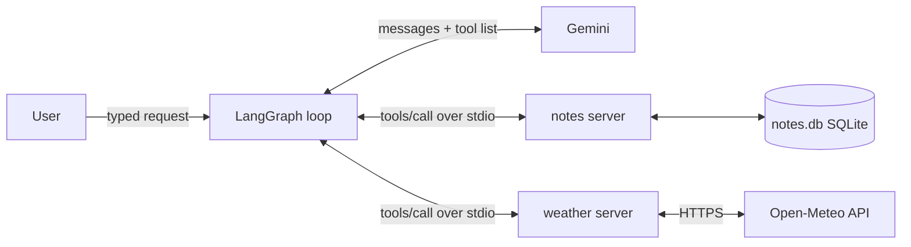
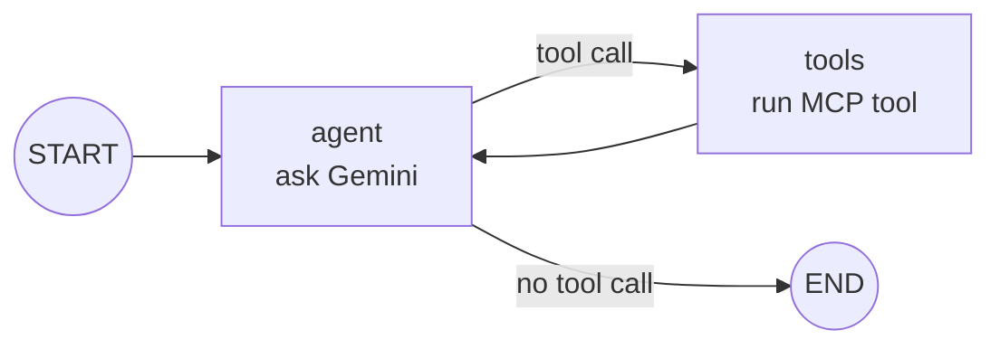
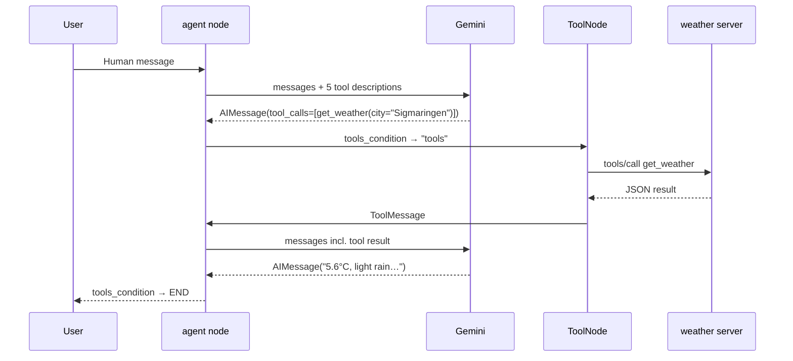

# Assist: Learning Notes

My reference for how Assist works and why it's built this way. Updated at the end of each day.
`PROGRESS.md` tracks *what* got done; this file explains *how and why*.

**Contents**
1. [The big picture](#1-the-big-picture)
2. [Glossary](#2-glossary)
3. [Day 0: Setup](#3-day-0-setup)
4. [Day 1: Skeleton](#4-day-1-skeleton)
5. [Gotchas and fixes](#5-gotchas-and-fixes)
6. [Command cheat sheet](#6-command-cheat-sheet)
7. [Explain it in an interview](#7-explain-it-in-an-interview)

---

## 1. The big picture

An AI assistant has three jobs, and Assist splits them into three parts:

| Role | What it does | In Assist |
|---|---|---|
| **Hands** | Do things: save a note, fetch weather. Make no decisions. | MCP servers (`mcp_servers/`) |
| **Brain** | Decides *which* tool to call and *with what* arguments | Gemini Flash-Lite (via LiteLLM) |
| **Loop** | Gives the brain the tool list, runs the chosen tool, feeds the result back, repeats | LangGraph graph (`backend/assist/graph/`) |



> **Key idea:** the brain never touches a database or an API. It only *asks* for tools. The servers do the work.

---

## 2. Glossary

| Term | Plain meaning |
|---|---|
| **MCP** (Model Context Protocol) | A standard "plug shape" for tools, so any AI app can use any tool server. |
| **MCP server** | A small program that offers tools (name + inputs + description). |
| **MCP client** | The program that connects to servers, lists their tools and calls them. Here, `MultiServerMCPClient`. |
| **Tool** | One function the AI can call, e.g. `add_note(text)`. |
| **Transport** | How client and server talk. **stdio** = the client starts the server as a subprocess and they exchange JSON over stdin/stdout. **streamable-http** = the server runs as a web service (needed for deployment later). |
| **FastMCP** | The part of the official MCP Python SDK that turns decorated functions into tools. |
| **MCP Inspector** | A web UI that acts as a manual MCP client. You click to do what the agent does automatically. |
| **LangGraph** | A library for building agent loops as graphs. |
| **State** | The data passed around the graph. For us, the list of messages. |
| **Node** | A function in the graph that reads the state and returns updates. |
| **Edge** | What runs next. A **conditional edge** picks the next node based on the state. |
| **`bind_tools`** | Attaches tool descriptions to the model, so each request says "here's what you can call." |
| **`ToolNode`** | Prebuilt node that runs whatever tool calls the model asked for. |
| **`tools_condition`** | Prebuilt router: if the last message has tool calls, go to `tools`; otherwise END. |
| **LiteLLM** | One interface for many LLM providers, so switching models is a one-string change. |
| **uv** | Fast Python project and package manager (replaces pip + venv). |

---

## 3. Day 0: Setup

- Keys for Gemini (AI Studio project `assist`), Groq and Langfuse (EU) live in `.env` only. `.env.example` lists the names with empty values.
- `scripts/smoke_test.py` checks all three keys work.
- `CLAUDE.md` tells Claude Code what it may and may not touch. The core is hand-written.

---

## 4. Day 1: Skeleton

**Goal:** typed requests answered through two own MCP servers (notes, weather).

### 4.1 uv project

```powershell
uv init --bare --python 3.12     # creates pyproject.toml only
uv python pin 3.12               # writes .python-version
uv add "mcp[cli]" httpx ...      # installs into .venv, records in pyproject.toml + uv.lock
```

- `pyproject.toml` lists what the project needs.
- `uv.lock` pins exact versions, so a fresh clone gets an identical setup.
- `uv run <cmd>` runs a command inside the project's `.venv`, with no activation needed.

### 4.2 Notes MCP server: `mcp_servers/notes/server.py`

**Tools**

| Tool | Returns | Why it returns that |
|---|---|---|
| `add_note(text)` | `{id, text, created_at}` | The **id** lets Day 2's undo delete exactly what was added. |
| `list_notes(limit=10)` | latest notes, newest first | `limit` keeps responses small (fewer tokens, less confusion). |
| `search_notes(query, limit=10)` | matching notes | The main voice use case: "what did I note about…?" |
| `delete_note(id)` | `{deleted: true, ...the note}` or `{deleted: false, error}` | Returns the deleted text so undo can **restore** it. |

**Design decisions**
- **One `text` field, not title + content.** People say "note: buy milk", not a title and a body.
- **No `update_note` yet.** Undoing an update means storing the old version first, so it's left out until needed.
- **Return dicts, not formatted strings.** The model reasons better over structured data.
- **Docstrings say *when* to use a tool, not just what it does.** The model sees only the name, type hints and docstring, so the docstring *is* the interface. Cross-references ("for an overview, use list_notes") help the model pick the right tool.

**Code patterns worth remembering**

```python
DB_PATH = Path(__file__).parent / "notes.db"   # path relative to this file, not the cwd
conn.row_factory = sqlite3.Row                 # rows act like dicts → dict(row)
with get_conn() as conn: ...                   # commits automatically at the end of the block
conn.execute("... WHERE id = ?", (id,))        # ? placeholders = no SQL injection
                                               # (id,) needs the comma to be a tuple
cur.lastrowid                                  # id SQLite just assigned
conn.execute(...).fetchone()                   # one row, or None
{"deleted": True, **dict(row)}                 # merge the row's fields into the result
```

**Why `delete_note` runs a SELECT before the DELETE:** once the row is gone, its text is gone. Reading it first keeps what undo needs.

**How search works:** `LIKE '%dentist%'` is plain substring matching, case-insensitive for English letters. There's no AI in the server. "doctor appointment" won't find "dentist", but the *model* can choose a good keyword and retry. Semantic search with embeddings is an optional later upgrade.

### 4.3 Weather MCP server: `mcp_servers/weather/server.py`

One tool: `get_weather(city, days=1)`, using Open-Meteo (free, no key). It makes two API calls in a row:

1. **Geocoding:** `geocoding-api.open-meteo.com/v1/search?name=…` turns the city into latitude and longitude.
2. **Forecast:** `api.open-meteo.com/v1/forecast` turns those coordinates into current weather plus a daily forecast.

- `httpx.get(url, params={...})` builds the query string safely, including umlauts and spaces.
- `days = max(1, min(days, 7))` clamps bad input before the API sees it.
- If the city isn't found, it returns `{"error": ...}` instead of crashing.
- Weather codes are mapped to words ("light rain"), and the response is trimmed to what matters.

### 4.4 Testing servers with the MCP Inspector

```powershell
uv run mcp dev mcp_servers/notes/server.py
```

```
Browser UI (localhost:6274) ⇄ Inspector proxy ⇄ server.py (subprocess, stdio)
```

The three MCP messages you trigger:

| Message | When | What it does |
|---|---|---|
| `initialize` | on connect | Handshake: agree on the protocol version |
| `tools/list` | List Tools | Server returns each tool's name, description and input schema |
| `tools/call` | Run Tool | Sends `{"name": ..., "arguments": ...}` and gets the result |

**In the Inspector, *you* are the brain.** The agent later does exactly the same thing automatically.

**Notes server test checklist:** list on empty DB → add 2 notes → list (newest first) → list with `limit=1` → search in uppercase → search for something missing → delete → delete the same id again (expect not-found) → Restart → list (data persisted).

### 4.5 LangGraph agent: `backend/assist/graph/agent.py`

**The graph**



**One request, step by step:** "What's the weather in Sigmaringen?"



**The code in 4 parts**

| Part | What it does |
|---|---|
| `MultiServerMCPClient({...})` | Says how to start each server. Replaces the Inspector. |
| `await client.get_tools()` | Starts the servers, sends `tools/list`, turns each MCP tool into a LangChain tool. |
| `ChatLiteLLM(...).bind_tools(tools)` | The brain, told which tools exist. |
| `StateGraph(MessagesState)` + nodes + edges + `.compile()` | The loop. |

**The key line**
```python
response = await model.ainvoke(state["messages"])
```
This sends the *whole* conversation to Gemini, which has no memory between calls. The response is either a **tool request** (`response.tool_calls`) or a **final answer** (`response.content`). This is where the AI makes its decision.

**Chat history:** after each turn, `messages = result["messages"]`, so the next turn includes everything. That's how "delete it" knows what "it" is. `result["messages"][len(messages):]` slices out only this turn's new messages.

**Why the graph is built by hand instead of using a prebuilt agent:** on Day 2, an `approve` node goes between `agent` and `tools`. You can only do that if you own the graph.

**Model choice:** `gemini/gemini-3.1-flash-lite`, about $0.001 per request. Flash is for multi-step and vision; Pro is only for tool-building.

---

## 5. Gotchas and fixes

| Problem | Cause | Fix |
|---|---|---|
| Inspector shows the old server's tools | The Inspector remembers the last command in the browser | Change **Arguments** on the left, then Restart (or Ctrl+C, then run again and open the new URL) |
| No API URL visible on the Open-Meteo docs page | The example URL only appears after you search on the page | The endpoint is listed in the "API Documentation" section |
| `ImportError: cannot import name 'CacheableResult' from 'mcp.types'` | litellm 1.106.x needs mcp 2.x, but langchain-mcp-adapters needs mcp < 2 | `uv add "litellm>=1.101,<1.106"`. Remove the pin once the adapters support mcp 2. |
| Long call IDs containing `__thought__` | Gemini's thought signature on tool calls | Normal, ignore it |
| `(limit)` instead of `(limit,)` | Without the comma, it's just parentheses, not a tuple | Always write `(x,)` for one parameter |

---

## 6. Command cheat sheet

```powershell
uv add <pkg>                                   # add a dependency
uv run python scripts/smoke_test.py            # check keys
uv run mcp dev mcp_servers/notes/server.py     # Inspector for one server
uv run python backend/assist/graph/agent.py    # terminal chat with the agent
git status; git add .; git commit -m "..."; git push
```

---

## 7. Explain it in an interview

**"Walk me through your MCP server."**
> It's a FastMCP server with four tools over SQLite. Each tool's type hints become its input schema, and its docstring tells the model when to use it. Write tools return what's needed to reverse them: `add_note` returns the id, and `delete_note` reads the row before deleting so it can be restored. That's the basis for undo.

**"How does your agent decide what to do?"**
> A LangGraph loop with two nodes. The agent node sends the conversation and tool descriptions to Gemini. If Gemini returns tool calls, a conditional edge routes to a ToolNode, which runs them through MCP and loops back. If it returns plain text, the graph ends.

**"Why MCP instead of plain function calling?"**
> MCP makes tools reusable and swappable. The same servers work with my agent, the Inspector, Claude Desktop or any other MCP client, and I can add third-party servers like GitHub without writing integration code.

**"Why build the graph by hand?"**
> So I can insert nodes like human approval before write actions, and an action log for undo. Both need control over the graph structure.
