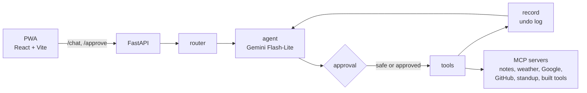

# How it works

[← Back to the README](../README.md)

- **PWA → FastAPI.** The UI sends one message per request. Conversations live on the server in a LangGraph checkpointer, keyed by a thread id.
- **Tool routing.** A cheap router call picks the tool groups a message needs (calendar, email, code, …). The agent only sees those tools, plus the previous turn's and `undo_last_action`. If the router fails, the agent gets every tool.
- **Approvals.** Only tools on a safe list run directly. For any other call, the graph pauses with `interrupt()`, and `/chat` returns `pending` instead of a reply. The UI shows an approval card (an email preview for drafts, the code and tests for built tools). `/approve` resumes the thread. A denied call never runs.
- **Undo.** After tools run, the `record` node stores each successful change with its reverse, e.g. `create_event` → `delete_event(id)`, in SQLite. "Undo that" runs the newest reverse. An undo that can never succeed (the event is already gone) is closed and reported. One that failed on sign-in or the network stays open to retry.
- **Routines.** "Start my day", "Wrap up", "Where was I?" and "What did you do for me this week?" are fixed recipes in code. They read their sources in parallel, and one model call writes the brief. Counts and dates are computed in code, never by the model.
- **Model outages.** If Gemini is over quota, times out or returns a 5xx, `/chat` and `/approve` still answer normally: the reply says the AI service is unavailable and nothing was changed. If an approved change had already run, the reply says so and the steps panel shows it.
- **Steps panel.** Every reply lists what happened: plans, approvals, tool runs and undo entries.
